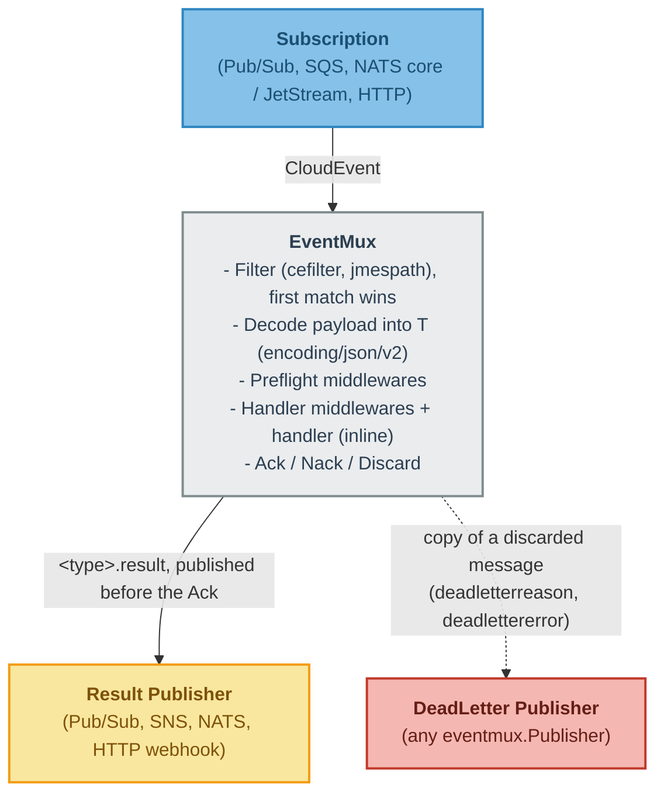
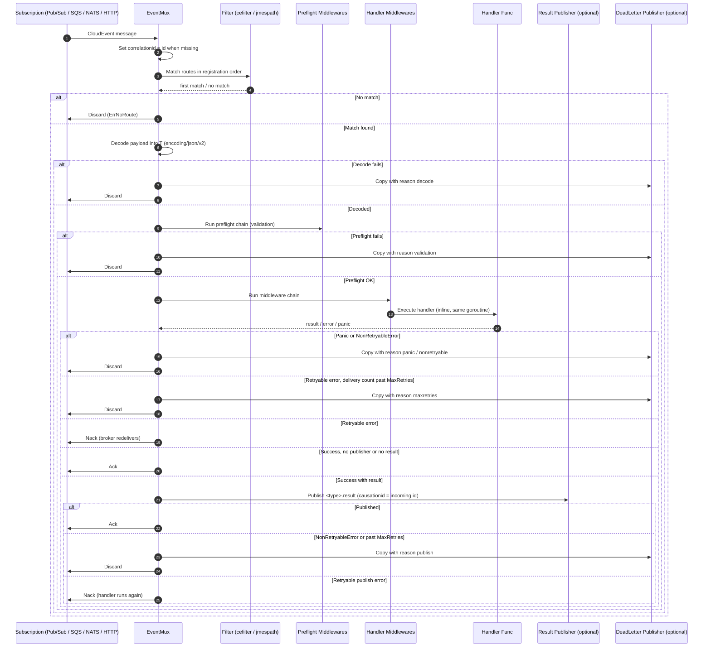

# Event-Driven — CloudEvents Multiplexer Library

A Go library for routing and processing events from multiple sources (Google Cloud Pub/Sub, AWS SNS+SQS, NATS core and JetStream, HTTP) using the [CloudEvents](https://cloudevents.io/) standard.

## Key Features

- **EventMux** — Multiplexes events to handlers based on filters, analogous to `http.ServeMux` for events.
- **CloudEvents native** — `Message` composes `cloudevents.Event` with delivery mechanics (Ack/Nack).
- **Stateless** — No in-memory queue. The transport SDK controls concurrency. Crash-safe by design.
- **Multiple transports** — GCP Pub/Sub, AWS SNS (publish) + SQS (subscribe), NATS core + JetStream (fan-out), HTTP (sync). Swappable through `eventmux.Publisher` / `eventmux.Subscription` interfaces.
- **Filter families** — CloudEvent attributes (`cefilter`), payload content (`jmespath`), combinations.
- **Middleware pipeline** — validation, error skipping, in-process retry with exponential backoff and jitter. Panics are always recovered by the mux.
- **One wire format** — every transport maps CloudEvents with the same binary / structured codec; the NATS and SNS publishers accept a custom `Marshaler` (subject from the event type, FIFO attributes).
- **Non-retryable errors** — `event.NonRetryableError` triggers Ack (discard) instead of Nack (redeliver).
- **Poison-message policy** — decode, validation, panic and `NonRetryableError` failures are discarded on the first delivery; retryable errors respect `Config.MaxRetries` when the broker reports a delivery count, and are definitive on a transport that cannot redeliver (reason `noredelivery`); every discarded message can be copied to a `Config.DeadLetter` publisher.
- **Structured logging** — `log/slog` with the platform logging standard via [`httpgate/logging`](https://github.com/norlis/httpgate) (OTel field names, ISO 8601 UTC timestamps, structured `error.*` objects) and W3C `traceparent` propagation across every transport (HTTP headers, Pub/Sub / SQS / SNS message attributes, NATS headers, CloudEvents `traceparent` extension). See `docs/superpowers/specs/2026-08-12-logging-standard-design.md` for the field and message catalog.
- **FX integration** — `pkg/kit/fxmux` plugs the mux + FX lifecycle hooks + slog-based fxevent logger.

## Installation

```bash
go get github.com/norlis/event-driven/v2
```

Requires Go 1.27+.

### Transport dependencies are on demand

The module declares every transport SDK (AWS, Google Cloud Pub/Sub, NATS, resty) in one `go.mod`, but a consumer only pays for the transports it imports. Since Go 1.17 the `go` command prunes the module graph and loads modules lazily: the SDKs behind a transport you never import are not downloaded, compiled, linked or recorded in your `go.sum`. They only remain visible in `go list -m all` and `go mod graph`, and they set a minimum version if your own module also depends on the same SDK directly.

Measured on 2026-10-21 with a module that imports only `pkg/eventmux` and `pkg/transport/eventhttp`:

| What the consumer gets | Result |
|---|---|
| `require` lines in its `go.mod` | 9 indirect (cloudevents, httpgate, resty, zap, …), none from AWS, Pub/Sub, NATS or gRPC |
| AWS / Pub/Sub / NATS entries in its `go.sum` | 0 |
| Packages from those SDKs compiled (`go list -deps`) | 0 |
| Modules from those SDKs in `go list -m all` | 21 of 167 |

Reproduce it with:

```bash
mkdir consumer && cd consumer && go mod init consumer
cat > main.go <<'EOF'
package main

import (
	"github.com/norlis/event-driven/v2/pkg/eventmux"
	"github.com/norlis/event-driven/v2/pkg/transport/eventhttp"
)

func main() { _ = eventmux.New; _ = eventhttp.NewPublisher }
EOF
go mod tidy && grep -c aws-sdk go.sum; go list -deps ./... | grep -c 'aws-sdk\|cloud.google.com/go/pubsub\|nats-io'
```

Both counts print `0`. See the [module graph pruning](https://go.dev/ref/mod#graph-pruning) section of the Go Modules Reference.

## Quick Start

```go
import (
    "context"

    "github.com/norlis/event-driven/v2/pkg/eventmux"
    "github.com/norlis/event-driven/v2/pkg/filter/cefilter"
    "github.com/norlis/event-driven/v2/pkg/transport/gcp/pubsub"
)

mux, err := eventmux.New(eventmux.Config{
    Subscription: subscription, // pubsub.Subscriber, sqs.Subscriber, eventhttp.Subscriber, …
    Logger:       logger,       // *slog.Logger
})

mux.Handle(
    publisher,                                    // where to publish the result (nil = fire-and-forget)
    cefilter.ByType("com.example.order.created"), // filter by CloudEvent type
    orderHandler.Execute,                         // func(context.Context, Order) (jsontext.Value, error)
)

if err := mux.Start(ctx, nil); err != nil { // returns once the subscription is up
    return err
}
<-ctx.Done()
_ = mux.Stop(shutdownCtx) // drains in-flight handlers until shutdownCtx expires
```

## Architecture

```
├── example/                            # End-to-end demo wired with Uber FX
│   ├── cmd/main.go                     # FX bootstrap, health endpoints
│   ├── module.go                       # FX providers (clients, muxes, subscriptions)
│   ├── events.go                       # Route registration with filters and handlers
│   ├── handlers.go                     # Use-case implementations
│   ├── observer.go                     # Example Observer: counts outcomes per event type
│   ├── test.http                       # Ready-to-fire requests
│   └── nats/                           # Self-contained HTTP → JetStream demo (compose.yaml + main.go)
└── pkg/
    ├── event/                          # event.Message (Ack/Nack/Discard, Outcome), errors, DeadLetterReason,
    │                                   # correlation/causation extensions, W3C traceparent helpers
    ├── eventmux/                       # The mux itself + Publisher/Subscription/Filter contracts
    │   ├── mux.go                      # eventmux.New, Mux, Config, Mux.Handle[T], result publication
    │   ├── failure.go                  # Failure classification, dead-letter copy, panic recovery
    │   ├── observer.go                 # Observer contract (outcomes + publish results)
    │   ├── handler.go                  # HandlerFunc
    │   ├── middleware.go               # Middleware, eventmux.Chain
    │   ├── interfaces.go               # Publisher, Subscription, Filter (consumer-side)
    │   └── metadata/                   # Per-message key-value store (context-scoped)
    ├── middleware/                     # Built-in middlewares, one package per concern
    │   ├── validate/                   # go-playground/validator on the decoded payload
    │   ├── retry/                      # In-process retry with exponential backoff + jitter
    │   └── skiperr/                    # Swallow specific errors (predicate-based)
    ├── filter/                         # Filter implementations
    │   ├── cefilter/                   # By CloudEvent type / source / AND composition
    │   └── jmespath/                   # JMESPath expression on the JSON body
    ├── transport/                      # Concrete Publisher / Subscription implementations
    │   ├── internal/envelope/          # CloudEvents binary/structured mapping shared by every transport
    │   ├── gcp/pubsub/                 # Pub/Sub publisher, subscriber, health, marshaler/unmarshaler
    │   ├── aws/                        # Shared AWS SDK config + Identity (region + STS account)
    │   │   ├── sns/                    # SNS publisher + marshaler
    │   │   └── sqs/                    # SQS subscriber + unmarshaler (long-polling + workers)
    │   ├── nats/
    │   │   ├── codec/                  # Shared NATS header marshaler/unmarshaler
    │   │   ├── core/                   # Core NATS publisher + subscriber (no persistence)
    │   │   ├── jetstream/              # JetStream publisher, subscriber (ephemeral consumers), health
    │   │   └── natsconn/               # NATS connection whose Stop drains and waits until closed
    │   └── eventhttp/                  # HTTP subscriber + publisher (CloudEvents bindings)
    └── kit/                            # Cross-cutting utilities
        ├── fxmux/                      # BindGroup (one fx hook for a lifecycle.Group) + slog fxevent.Logger adapter
        ├── httpserver/                 # http.Server as a start/stop component (bind fails in Start)
        ├── lifecycle/                  # Component, Closer, Group: ordered start, reverse stop, Run for main()
        ├── logfields/                  # Log field keys, Outcome values, component-scoped loggers
        └── signal/                     # Signal-aware context (SIGINT/SIGTERM)
```

> Package-oriented layout (Bill Kennedy style): packages are organized by capability, not by Clean Architecture layer. There is no `domain/`, `application/`, `port/`, or `adapter/` namespace — interfaces live where they are consumed (`eventmux/interfaces.go`).

## Flow Diagram





Every `DLQ` step happens only when `Config.DeadLetter` is set; when that copy fails with a retryable error, the message is nacked for another attempt only while `Config.MaxRetries` bounds the redelivery (the broker reports a delivery count still within the limit); otherwise the copy is lost and the message discarded. With `Config.PublishAfterAck: true` the success branch acks first and a publish failure is only logged. Every outcome is reported once to `Config.Observer`.

## Core Concepts

### Message

`event.Message` composes `cloudevents.Event` (CNCF v1.0.2) with delivery mechanics that CloudEvents doesn't cover:

```go
type Message struct {
    cloudevents.Event           // Embedded: ID(), Type(), Source(), Data(), Extensions()...
    // + Ack(), Nack(err), Discard(err) error // Delivery decision (once-only); returns the broker's error
    // + Outcome() (Outcome, error)      // What the router decided and why; read by synchronous transports (HTTP)
    // + Context()                       // Per-message context, cancelled once the outcome is decided
}
```

### EventMux

Stateless multiplexer. Handlers execute inline in the broker SDK's goroutine — no in-memory job queue, no second pool of workers. Concurrency is controlled by the transport (`NumGoroutines` for Pub/Sub, `ConsumeWorkers` for SQS, request goroutines for HTTP).

```go
mux, err := eventmux.New(eventmux.Config{ // error when Subscription is nil
    Name:         "orders",      // appears in logs
    Subscription: subscription,
    Logger:       logger,        // *slog.Logger; default: discard
})
```

A message with no matching route is discarded (`Outcome() = Discarded, ErrNoRoute`) and logged at INFO.

`mux.Start(ctx, onError)` establishes the subscription and returns: a missing queue, stream or subscription fails here, synchronously. `onError` (optional) is called once if the subscription later dies for good. `mux.Stop(ctx)` drains in-flight handlers until `ctx` expires. When the broker refuses an ack, nack or term, the mux logs a single `message ack failed` (ERROR) with the intended outcome; the router's decision is still recorded in `Message.Outcome()`.

Routes and middlewares are registered before `Start`; `Handle`, `Use` and `UsePreflight` panic afterwards, and so does a second `Handle` with a filter already registered, whatever its publisher: the first matching route wins, so the second one could never run.

### HTTP subscriber

`eventhttp.Subscriber` runs the router synchronously and answers with its outcome: `202` only when the event was acked, `4xx` by `ErrorRule` (validation, no route, undecodable payload, or your own rules), `500 HANDLER-FAILED` with a generic detail when the handler failed. Plain JSON requests get `DefaultType`; CloudEvents binary and structured modes are detected automatically.

```go
sub, err := eventhttp.NewSubscriber(serveMux, eventhttp.SubscriberConfig{
    Pattern:      "POST /command",
    DefaultType:  "http.command",          // type for plain JSON requests (required)
    MaxBodyBytes: 256 << 10,               // default: 256 KiB, the SNS/SQS message limit
    ErrorRules: []eventhttp.ErrorRule{     // evaluated before the defaults
        eventhttp.NewRuleForValue(ErrOrderExists, http.StatusConflict, "ORDER-EXISTS", "Order already exists"),
    },
}, logger)
```

Clients may send `X-Correlation-ID` (plain) or `Ce-Correlationid` (binary); otherwise the subscriber sets `correlationid` to the event `id`, the same rule the mux applies on every transport. The id travels as the `correlationid` extension into every derived event and comes back in the response:

```json
{"id":"0199c2f1-4e8a-7c3b-9f12-5a6b7c8d9e0f","type":"http.command","correlationId":"0199c2f1-4e8a-7c3b-9f12-5a6b7c8d9e0f","timestamp":1760486400,"instance":"POST /command","status":202}
```

### Transports

Every transport package provides at least a `Publisher`, a `Subscriber`, or both. They satisfy `eventmux.Publisher` / `eventmux.Subscription` structurally — no need to import `eventmux` from inside the transport package.

| Package | Publisher | Subscriber | Notes |
|---|---|---|---|
| `pkg/transport/gcp/pubsub` | `pubsub.Publisher` | `pubsub.Subscriber` | + `HealthChecker` for `/ready` probes |
| `pkg/transport/aws/sns` | `sns.Publisher` | — | Pub-only (SNS is fanout) |
| `pkg/transport/aws/sqs` | — | `sqs.Subscriber` | Long-polling, configurable workers |
| `pkg/transport/eventhttp` | `eventhttp.Publisher` | `eventhttp.Subscriber` | Binary + structured + plain JSON |
| `pkg/transport/nats/core` | `core.Publisher` | `core.Subscriber` | Core NATS, native fan-out (no persistence) |
| `pkg/transport/nats/jetstream` | `jetstream.Publisher` | `jetstream.Subscriber` | JetStream, **fan-out via ephemeral consumers** + `HealthChecker` |

The NATS transport is **fan-out**: every running instance receives **every** event — the opposite of SQS competing consumers (where one instance per message wins). This is the model to use when all instances must react to the same events (cache invalidation, config refresh, broadcast).

- **`core`** — a plain `Subscribe` (empty `QueueGroup`) delivers to all subscribers. No persistence: events arriving while an instance is down are lost. Ack/Nack are no-ops
- **`jetstream`** — each instance creates its **own ephemeral consumer** on a shared stream with `DeliverPolicy=New`.
  Every instance gets every new event; the consumer is auto-created at startup and auto-removed (`InactiveThreshold`) when the instance dies. Within a live instance, a failed handler `Nak`s and the message is redelivered. Events arriving while an instance is **down** are missed by that instance (by design).

Provisioning: the **stream** is assumed to exist in production (created by IaC/ the `nats` CLI); set a non-nil `StreamConfig` (its `Name` must equal `Stream`) to create or update it at `Start` for local/dev. Per-instance **consumers** are always auto-created at runtime. Use `jetstream.NewHealthChecker(js, jetstream.WithStreams("ORDERS"))` for `/ready`.

> **Need work-queue (one instance per message) instead?**
> That is a future additive change — a `Durable` field on `jetstream.SubscriberConfig` switches  to a shared durable consumer.

**AWS names instead of ARNs/URLs** — SNS derives the topic ARN from `aws.Identity{Config: awsCfg}` (partition and account via one cached `sts:GetCallerIdentity`, region from `awsCfg.Region`); SQS resolves a queue name with `GetQueueUrl` at `Start` (no STS, any partition, fails fast when the queue is missing):

```go
awsCfg, _ := aws.NewConfig() // no default region: set AWS_REGION or the shared config
identity := &aws.Identity{Config: awsCfg}

pub, _ := sns.NewPublisher(snsClient, sns.PublisherConfig{
    Topic:    "orders",        // → arn:<partition>:sns:<region>:<account>:orders
    Identity: identity,
}, logger)

sub, _ := sqs.NewSubscriber(sqsClient, sqs.SubscriberConfig{
    Queue: "orders",           // resolved with GetQueueUrl; AckTimeout bounds each DeleteMessage (default 5s)
}, logger)
```

ARNs / URLs already qualified are accepted unchanged — the resolver detects the prefix (`arn:` for SNS, `https://` for SQS) and makes no lookup. A transient STS failure is not cached: `Identity` retries on the next call.

### Wire format

| Transport | Behavior |
|---|---|
| Pub/Sub | Binary mode: `ce-*` attributes (extensions included) + `Content-Type`; structured mode when `Content-Type: application/cloudevents+json`. Not pluggable. |
| `sns.DefaultMarshaler` (pluggable via `PublisherConfig.Marshaler`) / SQS | Same mapping on String `MessageAttributes`; assumes `RawMessageDelivery=true` for SNS→SQS. Falls back to structured mode when the binary attributes, `Content-Type` included, exceed 9 (the 10th is the native `traceparent`): body = CloudEvent JSON, `ce-id`, `ce-type`, `ce-source` kept as attributes for filter policies. |
| `codec.DefaultMarshaler` (pluggable via `PublisherConfig.Marshaler`) / `codec.Unmarshal` (NATS core + JetStream) | Same mapping on NATS headers; missing `ce-id` falls back to `Nats-Msg-Id` or a UUID v7. |
| `eventhttp` | Publisher sends `Ce-*` headers; subscriber uses the CloudEvents SDK (`cehttp.NewEventFromHTTPRequest`). |

All of them share one codec: `ce-time` is RFC 3339 with nanoseconds, non-string extensions are formatted with the SDK's `types.Format`, `Content-Type` comes from `datacontenttype` (default `application/json`), and an invalid structured envelope or `ce-time` is a decode error (dead-lettered), never a silent fallback.

Swap to support FIFO (`MessageGroupId`/`MessageDeduplicationId`), structured-mode publishing, legacy formats, encryption, compression, etc.

### Filters

Two filter families, composable:

```go
// CloudEvent attribute filters (no payload parsing)
cefilter.ByType("com.example.order.created", "com.example.order.updated")
cefilter.BySource("//pubsub.googleapis.com/")

// Payload-level filter (JMESPath on JSON body); the expression is compiled once, an invalid one fails here
premium, err := jmespath.New("contains(['premium', 'enterprise'], plan)", logger)

// Combined (AND)
cefilter.All(
    cefilter.ByType("com.example.order.created"),
    premium,
)
```

Route matching is **first-match-wins** — register routes from most specific to least specific.

### Middleware

```go
import (
    "github.com/norlis/event-driven/v2/pkg/middleware/validate"
    "github.com/norlis/event-driven/v2/pkg/middleware/retry"
    "github.com/norlis/event-driven/v2/pkg/middleware/skiperr"
)

mux.UsePreflight(validate.New())            // go-playground/validator before the handler
mux.Use(
    skiperr.New(logger,                     // outermost: sees the error retry gives up on
        skiperr.ByErr("not-found", ErrDataNotFound),
        skiperr.ByType[validator.ValidationErrors]("validator"),
    ).Middleware,
    retry.Backoff(200*time.Millisecond, 2*time.Second, 3),
)
```

`Use` chains the handler middlewares in registration order: the first one is the outermost, so `Use(A, B)` runs A, then B, then the handler. `UsePreflight` runs before the handler against a no-op terminal, to surface validation/authorization failures without invoking the user handler. Both, like `Handle`, panic if called after `Start`.

### Error Handling

```go
// Retryable → Nack → the broker redelivers; with Config.MaxRetries and a
// transport that reports delivery counts, delivery MaxRetries+1 is dead-lettered.
return nil, fmt.Errorf("database timeout: %w", err)

// Non-retryable → discarded on the first delivery (dead-letter copy if configured)
return nil, event.NewNonRetryableError(validationErr)
```

Decode failures, preflight (validation) failures and panics (see [Panic recovery](#panic-recovery)) are discarded on the first delivery as well. Configure the policy on the mux:

```go
mux, err := eventmux.New(eventmux.Config{
    Subscription: subscription,
    MaxRetries:   4,            // redeliveries tolerated for retryable errors (0 = unlimited)
    DeadLetter:   dlqPublisher, // any eventmux.Publisher; nil = discard with a log only
    Logger:       logger,
})
```

The dead-letter copy is the original CloudEvent (same `id`) plus `deadletterreason` and `deadlettererror`. Delivery counts come from the broker: JetStream always, SQS through `ApproximateReceiveCount`, Pub/Sub only when the subscription has a dead-letter policy. Keep `MaxRetries + 1` below the broker's own limit (`MaxDeliver`, `maxReceiveCount`, `--max-delivery-attempts`), otherwise the broker removes the message before the mux can dead-letter it:

```bash
gcloud pubsub subscriptions update my-sub \
  --dead-letter-topic=my-dlq-topic --max-delivery-attempts=10
```

For SQS, configure `VisibilityTimeout` and `RedrivePolicy` on the queue. The `sqs.Subscriber` leaves nacked messages untouched so the visibility timeout drives redelivery.

### Panic recovery

There is no recovery middleware to register (the `pkg/middleware/recover` of v1 is gone): the mux recovers every panic on the message path itself, for every route and every transport, and treats it as a bug in the code rather than a transient failure, so it is never redelivered.

| Where the panic happens | What the mux does |
|---|---|
| Preflight middleware, handler middleware or the handler (`invoke`) | Dead-letter copy with reason `panic`, then `Discard` on the first delivery. One ERROR record (`message dead-lettered` / `message discarded`) with the panic value in `error.message` and the stack captured at the panic site in `error.stack_trace`. `Message.Outcome()` reports `Discarded` with `event.ErrPanic` as cause; the HTTP subscriber answers `500 HANDLER-FAILED`. |
| `Filter.Match` or the payload decoder, before any route decided | Same as above: `handle` defers its own recover around everything that runs before the decision. |
| After the decision: a `Delivery` callback (ack, nack, term) or the dead-letter publisher | Logged once (`panic after message decision`) and swallowed: the broker was already told, so nothing is settled twice. A panic while settling a message that had itself panicked is logged (`panic while settling a panicked message`) and swallowed too. |
| `Observer.OnMessage` / `OnPublish` | Logged (`observer panicked`) and swallowed; the outcome never changes. |

Nothing escapes into the broker SDK's goroutine, which is the one that runs the whole path: a panic that did would kill the Pub/Sub receive loop, the SQS worker or the JetStream consumer. The stack is logged once, in its own field, not embedded in the error message, so `deadlettererror` on the copy stays short and readable.

```go
mux.Handle(pub, cefilter.ByType("com.acme.order.created"), func(ctx context.Context, o Order) (jsontext.Value, error) {
    return nil, nil // a panic here is dead-lettered with reason "panic" and discarded: no retry, no crash
})
```

### Result publication and acknowledgement

A handler that returns data on a route with a publisher produces a `<type>.result` event. The mux publishes it **before** acknowledging the incoming message, so a result is never lost silently:

| Publish outcome | Message outcome |
|---|---|
| success | Ack |
| any other error | Nack: the broker redelivers and the handler runs again |
| `NonRetryableError` or delivery past `MaxRetries` | dead-letter copy with reason `publish`, then Discard |

Only a publisher error wrapped in `event.NonRetryableError` stops the redelivery loop: `eventhttp.Publisher` classifies every `4xx` except `408` and `429` that way, a custom SNS `Marshaler` that exceeds the attribute limit (`ErrTooManyAttributes`); SDK errors from Pub/Sub, SNS and NATS are retried, so set `Config.MaxRetries` as the safety net.

Because a redelivery runs the handler again, **handlers must be idempotent**. The second result carries the same `causationid`, which lets consumers deduplicate. On the HTTP subscriber the `202` is sent only after the result is published; a retryable publish failure answers `500 HANDLER-FAILED`.

`Config.PublishAfterAck: true` restores at-most-once results: Ack first, then publish, and a publish failure is only logged (`result publish failed`).

### Observer

`Config.Observer` receives the mux's decisions without the mux depending on a telemetry library:

```go
type Observer interface {
    OnMessage(ctx context.Context, msg *event.Message, outcome logfields.Outcome, reason event.DeadLetterReason, elapsed time.Duration)
    OnPublish(ctx context.Context, ce cloudevents.Event, err error)
}
```

`OnMessage` runs exactly once per message after the outcome is decided (`acked`, `nacked`, `discarded`; `reason` is set when a classified failure was discarded or dead-lettered). `OnPublish` runs once per publish the mux issues, for results and dead-letter copies. Both run synchronously on the broker goroutine, so keep them fast; a panic inside the Observer is logged (`observer panicked`) and never changes the message outcome. `example/observer.go` counts outcomes per event type.

### Correlation and causation

Every event the mux handles ends up with two extensions:

| Extension | Value |
|---|---|
| `correlationid` | kept when the event carries one; otherwise set to the event `id` on entry, so the first event of a chain identifies the chain and a redelivery yields the same value |
| `causationid` | on result events, the `id` of the incoming event; each hop points at its immediate parent |

Both are reserved: handler metadata with those keys is ignored with a WARN, and an incoming `causationid` is not copied to the result. The dead-letter copy keeps the original `id` and `correlationid` and has no `causationid`, because it is the same event, not a derived one. Every per-message log record carries `messaging.message.correlation_id`.

### Graceful shutdown

`Subscription.Start(ctx, handler, onError)` returns once the subscription is established, so a setup failure aborts startup instead of surfacing minutes later. `Stop(ctx)` ends delivery and waits for in-flight handlers until `ctx` expires:

| Transport | Stop |
|---|---|
| Pub/Sub | cancels `Receive`, which returns after the in-flight callbacks finish |
| SQS | cuts the long-poll, finishes the batch in hand; each ack (`DeleteMessage`) runs on its own `AckTimeout` context so a shutdown never cancels it |
| JetStream | `Drain()` and waits for `Closed()`; a consumer the server stops without a `Stop` is reported through `onError` |
| NATS core | `Drain()` and waits until the subscription is invalid |
| HTTP | unwires the handler (requests get 503); `http.Server.Shutdown` drains in-flight requests |

The Pub/Sub publisher keeps one `*pubsub.Publisher` for batching: call `Close()` on shutdown to flush it, after the muxes that publish through it have drained.

`lifecycle.Group` gets that order right for you: components start in `Add` order and stop in reverse, so add resources first (clients, publishers, connections), then muxes, the HTTP server last. Subscriptions are not added: each mux starts and stops its own. A publisher is added only when it has something to close (`lifecycle.Closer(pub.Close)` for Pub/Sub; NATS publishers rely on the `*natsconn.Conn`, which is added instead).

### HTTP Content Modes

The HTTP subscriber accepts CloudEvents in three modes:

| Mode | Content-Type | Attributes | Data |
|---|---|---|---|
| Binary | `application/json` | `Ce-*` headers | HTTP body |
| Structured | `application/cloudevents+json` | Inside JSON body | `data` field in JSON |
| Fallback | `application/json` | Auto-generated defaults | HTTP body |

### Mux.Handle[T]

```go
func Execute(ctx context.Context, order Order) (jsontext.Value, error) { ... }

mux.Handle(pub, filter, handler.Execute) // T = Order, decoded with encoding/json/v2; *Order works too
```

`Handle` is a generic method (Go 1.27): the payload type is inferred from the handler, there is no `any` or reflection per message, and a payload that does not decode is dead-lettered with reason `decode`.

## Logging (slog)

The library uses `log/slog` exclusively. Construct a logger however you want and pass it in:

```go
import "log/slog"
import "os"

logger := slog.New(slog.NewJSONHandler(os.Stdout, &slog.HandlerOptions{Level: slog.LevelInfo}))
```

Nil loggers are accepted and default to `slog.DiscardHandler`. The library does **not** ship a logger factory — `slog.New(...)` is one line.

## FX Integration

`pkg/kit/fxmux` provides:

- **`fxmux.BindGroup(lc, shutdowner, group, logger)`** — runs a whole `lifecycle.Group` under one fx hook, so the group's `Add` order, not the order fx built each part, decides start and stop. `OnStart` is `group.Start` (a missing queue or a busy port aborts startup), `OnStop` is `group.Stop` with fx's stop context (`fx.StopTimeout`); a component that dies after startup triggers `fx.Shutdowner` with exit code 1.
- **`fxmux.NewLogger(*slog.Logger) fxevent.Logger`** — pipes FX events to slog. Only Started / Stopping / errors get logged; the verbose Provide/Invoke/Hook chatter is silenced.

```go
func BindLifecycle(lc fx.Lifecycle, sd fx.Shutdowner, logger *slog.Logger, p LifecycleParams) {
    g := lifecycle.NewGroup(logger, 0) // 0 → 25 s shutdown timeout
    g.Add("pubsub-client", lifecycle.Closer(p.Client.Close))
    g.Add("pubsub-publisher", lifecycle.Closer(p.Publisher.Close))
    g.Add(p.PubSubMux.Name(), p.PubSubMux)
    g.Add(p.HTTPMux.Name(), p.HTTPMux)
    g.Add("http-server", p.Server) // httpserver.New(serveMux, logger, server.WithAddr(addr))
    fxmux.BindGroup(lc, sd, g, logger)
}

fx.New(
    fx.WithLogger(fxmux.NewLogger),
    fx.Provide(NewLogger, NewMuxes, NewSubscriptions, ...),
    fx.Invoke(RegisterEventHandlers),
    fx.Invoke(BindLifecycle),
)
```

See `example/cmd/main.go` and `example/module.go` for a complete wiring.

## Without FX

`lifecycle.Group.Run` is the whole `main()` lifecycle: it starts the components, waits for SIGINT/SIGTERM or the first component failure, and stops everything within the shutdown timeout.

```go
conn, err := natsconn.Dial(natsconn.Config{URL: os.Getenv("NATS_URL")}, logger) // credentials never logged
js, err := jetstream.New(conn.Conn)
// ... publishers, subscriptions, muxes ...
g := lifecycle.NewGroup(logger, 0)
g.Add("nats", conn) // Stop drains and waits until the connection is closed
g.Add(natsMux.Name(), natsMux)
g.Add(httpMux.Name(), httpMux)
g.Add("http-server", httpserver.New(serveMux, logger, server.WithAddr(addr)))
if err := g.Run(ctx); err != nil {
    // errors.Is(err, lifecycle.ErrComponentFailed): the component already logged it
}
```

See `example/nats/main.go`.

## Versioning

```bash
VERSION=v2.0.0
git tag "${VERSION}" && git push origin "${VERSION}"
```

## Concurrency Tuning

Since EventMux is stateless, concurrency is controlled by the transport:

| Transport | Knob | Controls |
|---|---|---|
| GCP Pub/Sub | `NumGoroutines` | Concurrent receive goroutines (SDK) |
| GCP Pub/Sub | `MaxOutstandingMessages` | Max in-flight messages |
| GCP Pub/Sub | `MaxExtension` | How long the SDK extends the ack deadline |
| AWS SQS | `ConsumeWorkers` | Parallel polling goroutines |
| AWS SQS | `WaitTimeSeconds` (in `GenerateReceiveMessageInput`) | Long-polling window (max 20s) |
| AWS SQS | Queue `VisibilityTimeout` | How long a message is hidden after receive |
| NATS JetStream | `MaxOutstandingMessages` / `MaxOutstandingBytes` | Messages / bytes pulled per batch (`PullMaxMessages`, default 50) |
| NATS JetStream | `AckWait` | Redelivery window when a message is not acked (default 30s) |
| NATS JetStream | `NakDelay` | Delay before a nacked message is redelivered (0 = immediate) |
| NATS core | — | One callback goroutine per subscription (nats.go) |
| HTTP | — | One goroutine per HTTP request (Go runtime) |

## Example

A full end-to-end example lives under `example/` showing four cross-transport scenarios (HTTP↔Pub/Sub round-trip, JMESPath filtering, validation preflight) plus an `Observer` that counts outcomes. See [`example/README.md`](example/README.md) for the env vars and `example/test.http` for ready-to-fire requests.

`example/nats/` is a self-contained HTTP → JetStream → log demo that only needs a local NATS server: `docker compose -f example/nats/compose.yaml up -d && go run ./example/nats`.
